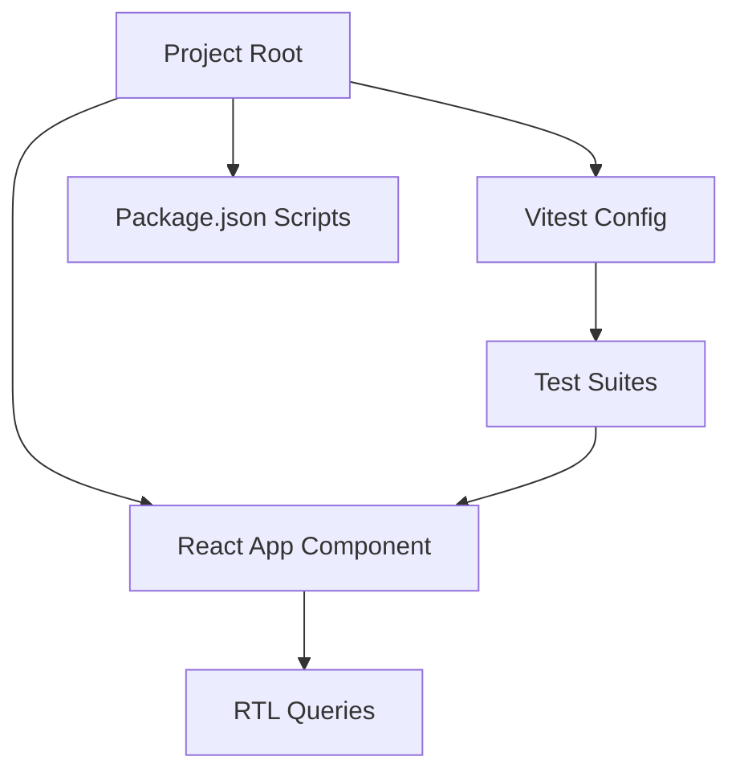

# Design: Testing Infrastructure

## Overview
This design defines the structure, patterns, and tooling approach for implementing unit testing in the portfolio React application.

## Architecture



## Implementation Approach

### Test Configuration
- Configure `vitest.config.ts` with:
  - `clearMocks: true` for test isolation
  - `coverage: { all: true, exclude: ['node_modules/'] }`
  - Support for `.tsx` test files with React 19
  - JSDOM environment setup

### Test Directory Structure
```
src/
├── components/
│   ├── <Component>/
│   │   ├── <Component>.tsx
│   │   └── <Component>.test.tsx
│   └── App/
│       ├── App.tsx
│       └── App.test.tsx
└── tests/
    ├── unit/
    │   └── <Feature>.test.ts
    └── integration/
        └── <Flow>.test.ts
```

### Test Patterns
- **Component Testing**:
  - Render components via `render()` from RTL
  - Use screen queries for element interaction
  - Test component props and state changes
  - Mock external dependencies (API, Router, etc.)

- **Test Coverage**:
  - Aim for 80% coverage across core components
  - Include positive and negative scenarios
  - Write tests that fail when functionality breaks

### Integration Steps
1. Install Vitest and React Testing Library dependencies
2. Configure Vitest in project configuration
3. Add test scripts to package.json
4. Write initial test suite for App component
5. Run tests and verify passing

## Technical Considerations

### Mocking Strategy
- Use `vi.mock()` for module mocking
- Provide mock implementations for:
  - API calls and external services
  - Browser APIs (localStorage, fetch)
  - Router components (React Router)

### Test Data
- Define test fixtures for consistent testing
- Use factories for generating test data
- Mock date/time for deterministic tests

### CI/CD Integration
- Configure GitHub Actions workflow for test execution
- Set up automatic test coverage reporting
- Implement test stage in deployment pipeline